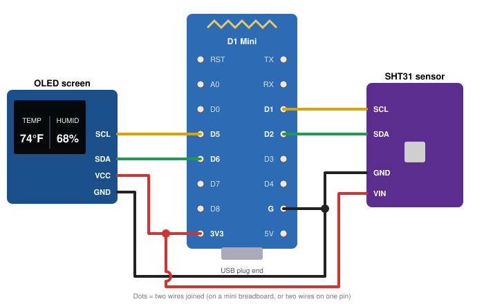

# DIY Greenhouse Gauge

A small screen that shows the **temperature (°F)** and **humidity (%)** next to your plants. It's beginner friendly:
**no coding, and the software installs with one click.**

> ## 👉 [Click here to install the software](https://chetsemail26.github.io/diy-greenhouse-gauge/)
> Open it on a computer in **Chrome** or **Edge**, with the gauge plugged in by USB.

📄 Prefer a printable version? [Download the PDF guide](Greenhouse-Gauge-Guide.pdf)

---

## The whole build in 3 steps

1. **Get the parts** (below)
2. **Connect 8 wires.** Every pin is labeled; you just match the labels.
3. **Click Install** on the [install page](https://chetsemail26.github.io/diy-greenhouse-gauge/). It takes about 2 minutes.

## 1. Get the parts

| Part | Qty | What to look for | Search for |
|---|---|---|---|
| **D1 Mini** board | 1 | ESP8266 based. Most come with a "CH340" USB chip; that's fine. | `Wemos D1 Mini ESP8266` |
| **SHT31** sensor | 1 | Small board with 4-6 pins. A **probe version** (sensor in a mesh tip on a cable) is great for humid greenhouses. | `SHT31 sensor module` |
| **1.3" OLED screen** | 1 | **Must be the 4-pin "I2C" version** (VCC, GND, SCL, SDA). The 6-7 pin "SPI" version won't work. | `1.3 inch OLED SH1106 I2C 4 pin` |
| **Jumper wires** | ~10 | Female-to-female if your boards have pins sticking out. | `dupont jumper wires female` |
| **Mini breadboard** | 1 | Optional but easiest: lets two wires share one pin. | `mini breadboard 170` |
| **USB cable** | 1 | Fits your D1 Mini (usually micro-USB) and must be a **data** cable, not "charge only". | `micro USB data cable` |
| **USB power adapter** | 1 | Any phone charger. | |

Boards often come with loose pins that need soldering. To skip soldering, buy them **"with headers soldered"**.

## 2. Connect the wires

Keep the USB cable unplugged while you wire.

| Wire | Screen pin → D1 Mini | Sensor pin → D1 Mini |
|---|---|---|
| Power | **VCC → 3V3** | **VIN → 3V3** |
| Ground | **GND → G** | **GND → G** |
| Clock | **SCL → D5** | **SCL → D1** |
| Data | **SDA → D6** | **SDA → D2** |

- Both parts need **3V3** and **G**, but the D1 Mini has one of each. Plug the D1 Mini into a mini breadboard and put both wires in the same row as the pin.
- Use **3V3**, not 5V.
- Go by the **printed labels**, not pin position. Brands put the pins in different orders.
- Extra pins on the sensor (ADR, AL)? Leave them empty.

## 3. Install the software

1. Plug the D1 Mini into a computer with the USB **data** cable.
2. Open the **[install page](https://chetsemail26.github.io/diy-greenhouse-gauge/)** in **Chrome** or **Edge**.
3. Click **Install**, pick the board (*USB Serial*, *CH340* or *usbserial*), click **Connect** and wait 1-2 minutes.
4. When it asks for Wi-Fi, enter yours, or skip it. The gauge works fine without Wi-Fi. Once it says the installation is complete, it offers a link to open the gauge's page with live readings.

**Board not in the list?** Swap the USB cable (most likely a charge-only one), try another port, or install the free **CH340 driver** from the chip maker, WCH (Windows and older Macs).

**With Wi-Fi:** on a phone or computer on the same Wi-Fi, open `http://greenhouse-gauge.local` for live readings. If that doesn't open (common on Android), use the gauge's address from your router's app.

**Change Wi-Fi later:** when the gauge isn't on Wi-Fi, it makes its own network called **Greenhouse-Gauge**. Join it from your phone, pick your Wi-Fi, and tap Save. (If no page pops up, open `192.168.4.1`.)

## Reading the gauge

| Screen shows | Meaning |
|---|---|
| **74°F / 68%** | Current reading |
| **--** | No reading from the sensor right now |
| **No WiFi** | Not on Wi-Fi (normal if you skipped Wi-Fi) |
| **SENSOR FAIL** | Sensor stopped answering and the gauge couldn't fix it |

| Blue light on the D1 Mini | Meaning | What to do |
|---|---|---|
| Off | All good | Nothing |
| Slow blink | No reading for 30+ seconds; fixing itself | Wait a few minutes |
| Fast blink | Gave up after 5 restarts | Check sensor wires, unplug and replug |

**Where to put it:** keep the board and screen *outside* the humid area, with only the sensor inside. Put the sensor at plant height, in the shade, away from heat mats and a few inches from the board.

## Troubleshooting

| Problem | Fix |
|---|---|
| Screen stays black | Check screen wires: SCL → D5, SDA → D6. VCC/GND not swapped? Is it the 4-pin I2C screen? |
| Screen shows **--** | Check sensor wires: SCL → D1, SDA → D2, VIN → 3V3, GND → G. Unplug and replug. |
| Readings jump when touched | Loose wire. Re-seat the wires or solder the joints. |
| Reads too warm or dry | Sensor is near the board, a lamp or a heat mat. Move it. |
| Wi-Fi won't connect | The gauge only joins 2.4 GHz Wi-Fi. Check the password. |

---

<b>For tinkerers</b>

The firmware is built with [ESPHome](https://esphome.io). The full config is
[`firmware/greenhouse-gauge.yaml`](firmware/greenhouse-gauge.yaml): change the layout, switch to °C, or add features,
then build it with `esphome run firmware/greenhouse-gauge.yaml`.

- Sensor on its own I2C bus (D2/D1), screen on another (D6/D5), both at 400 kHz, so a bad sensor can't freeze the screen.
- Self-heal: no reading for 2 minutes → restart, up to 5 times, then `Gauge Sensor Fault` turns on.
- Wi-Fi via Improv serial or the setup hotspot (captive portal).
- Web page: `/sensor/Greenhouse%20Temperature` (°C), `/sensor/Greenhouse%20Humidity`.

